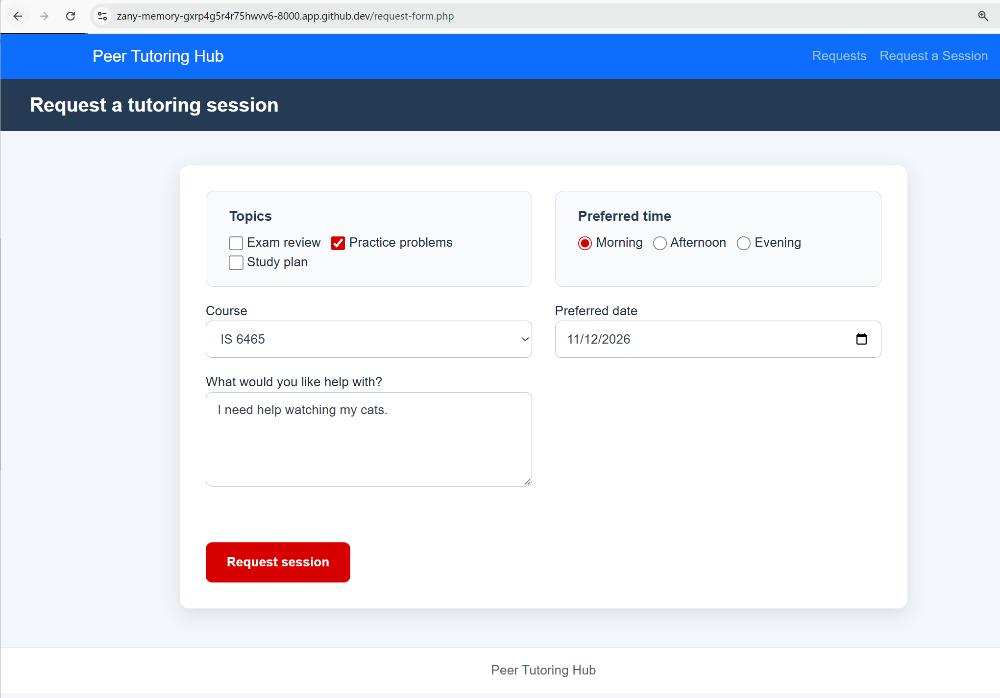
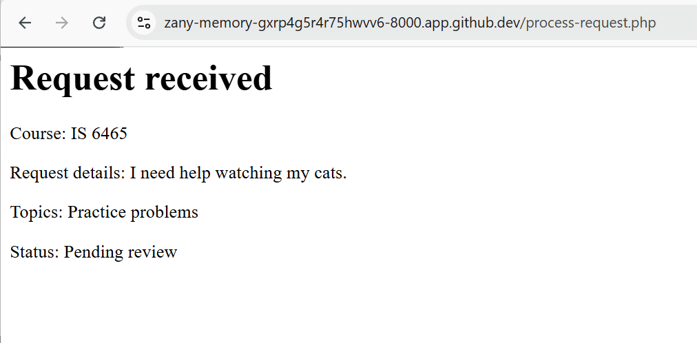

PART1: Run the application

1) When the tutor request form is submitted we are redirected to a confirmation page (process-request.php) which shows the parameters selected in the form (course, request details, and topic) along with a status message which says "pending."

2) Screenshots found in images-lab4-notes folder
Part1.1.png

Part1.2.png

PART2: Trace the templates

1)the header.php file provides a template for the peer tutor header that can be repeated on multiple pages. It is the top light blue ribbon. It also provides the primary connection the application has to the css.styles sheet.
2)the nav.php file provies a template for the navigation portion of the header where users can click on "requests" or "request a session."
3)the footer.php file provides a template for the white/gray ribbon at the bottom of the webpage that. 
4) the require_once construct allows developers to reference an element from another file mutliple times throughout a web page. With the header, nav, and footer php pages created, using the require_once command allows those elements to be used on any pages with single command. Then if the header needs to be edited, it only needs to be changed once in the header.php file rather than on every single web page.
5)the css.styles sheet is linked to the header file. Since the header is applied on every page of the web application, the css styles sheet will also be applied to every page.

PART3: Observe the form controls

1) reason 
    This control is a text area contorl. This allows gives users interacting with the webpage a full text box that they may enter information into. PHP receives a string from this control.
2) topics[]
    This control is a check box control. This allows user to select more than one option from a given list. When the form is submitted, PHP wil receive an array from this control.
3) preferredtime
    This control is a radio button control. This gives the user multiple buttons to select from, but they are only allowed to select one from the given option. PHP will receive a string from this control.
4) preferreddate
    This purpose of this control is to allow the user to select a date. It gives the calendar pop up box that allows users to select a date. PHP will receive a string from this control.
5) form_name
    This control is used as a hidden control. The user interacting with the form will not be able to see this or interact with it, but it is still contained on the web page, allowing this hidden data to be sent to the server with PHP scripts. PHP receives a string from this control.

Part 4: Test validation behavior

1)INPUTS: Topic= Practice Problems. Course= IS 6465 Reason= "I would like help watching my cats" Preferred Time= Morning Date= 11/12/2026. 
    When submitted I get a "Request received" message with all of my inputs. This means the request was successful and met all the business rules. Therfore, this request contained all the required information needed to submit a successful tutor request.
2)INPUTS: Topic= *LEFT BLANK*. Course= IS 6465 Reason= "I would like help watching my cats" Preferred Time= Morning Date= 11/12/2026. 
    When submitted I get a "Request could not be submitted." message. It specified to "Select at least one valid topic. Meaning that my request did not meet the business rule of needing to pick a topic for my tutoring session.
3)INPUTS: Topic= *LEFT BLANK*. Course= IS 6465 Reason= "I would like help watching my cats" Preferred Time= Morning Date= 10/12/2026.
    When submitted I get a "Request could not be submitted." message. On top of it specifiying to "Select at least one valid topic" I also got a message back saying "Preferred date cannot be in the past." The business rule being checked is the date of the tutoring session because you cannot have a tutoring session for a date that is already passed. Our form correctly throws an error if this is selected.

Part 5: Review testing and CRUD pages

CREATE (C) - request-form.php
READ (R) - request-details.php (single entry) requests.php (multiple entries)
UPDATE (U) - edit-request.php 
DELETE (D) - delete.request.php

1) On the requests.php page I opened the top entry with the ID of 12. This redirected me to the request-details.php but specifically to ID=12 (e.g. request-details.php?request_id=12)
2) The GET parameter is approvriate for viewing one request because we are not actually modifying anything. When the goal is to simply retreieve and view data in the database that is when the GET parameter is used.
3) We will use the POST parameter when we want to make updates or changes to the database because POST is handled with more caution because it is known to alter data. If a GET request was used when trying to delete something from the database that is dangerous because it will run with less vefification and caution as a POST.

