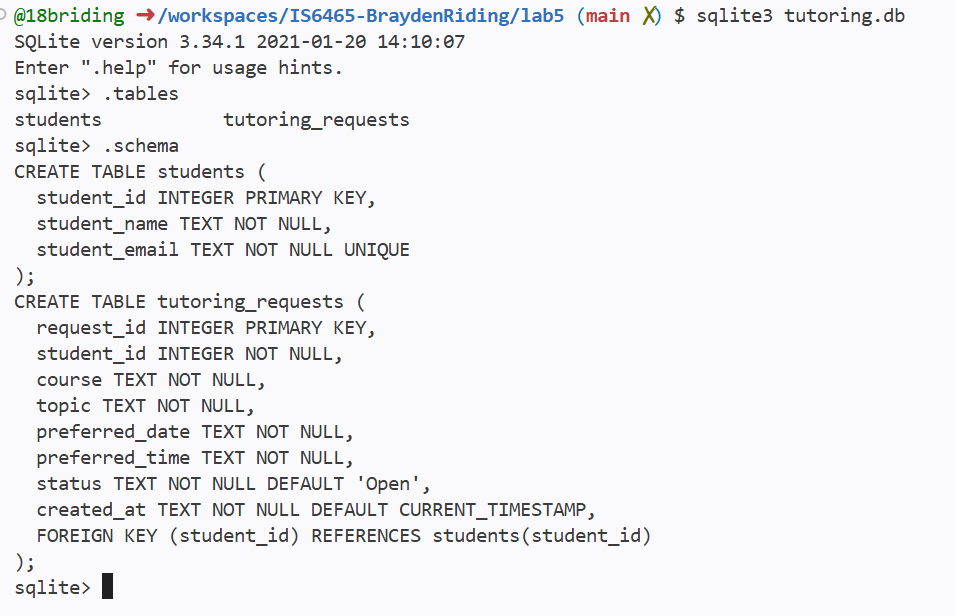
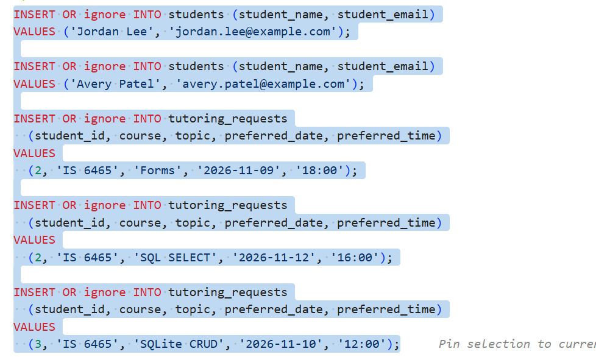
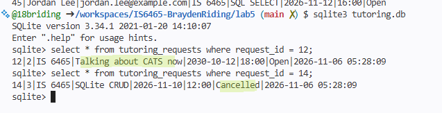
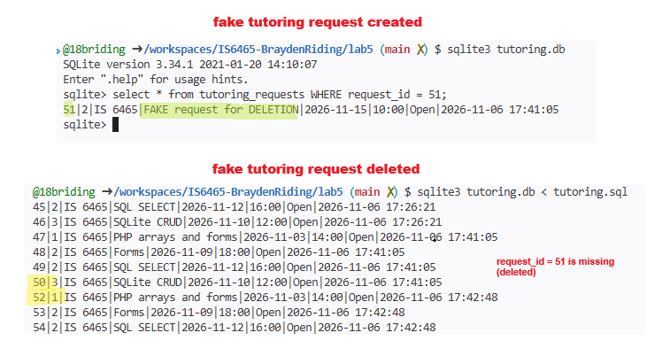
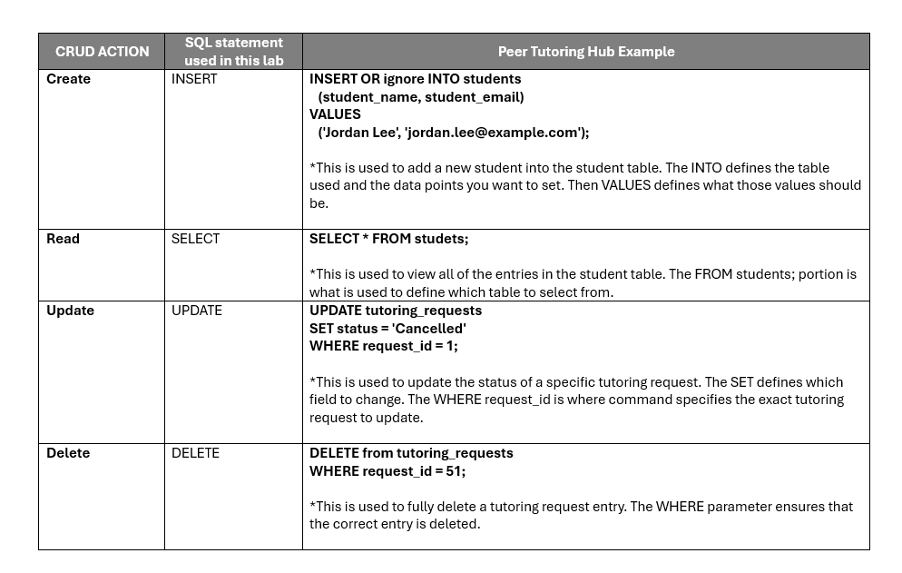

Part 1
  
    1. part1.1 in images folder

    2. In the students table primary key = student_id
        In the tutoring_request table primary key= request_id
    3. The foreign is found in the tutoring_request table and it is the student_id. A foreign key is a column that originates from a different table but can also be found in a different table in a database. This helps link / connect two different tables together.
    4. The student_email column is marked as unique because we want to ensure that no two rows in the student table have the same email address. This would cause confusion in the application and when replying to students (manually or automated).

Part 2
  
    1. part2.1 in images folder

    2. select * from students;
        select * from tutoring_requests;

    3. Jordan has one student row and two request rows because she represents only 1 student. However every time she makes a request, a new row in the tutoring_request is created. This data entry includes her student_id (foreign key) which ties to the student_id (primary key) in the students table. Since multiple tutor request entries from a single student can be tied to a single student_id, there does not need to be two rows / entries for Jordan in the student table.

Part 3
   
    (query)
            select 
            r.request_id,
            s.student_name,
            s.student_email,
            r.course, 
            r.topic,
            r.preferred_date, 
            r.preferred_time, 
            r.status
            from tutoring_requests AS r
            join students AS s ON r.student_id = s.student_id
            where r.requests_id IN (1, 12, 13, 18)
            order by r.preferred_date;

*NOTE* since "sqlite3 tutoring.db < tutoring.sql" is used to commit changed, it runs all of the previously written commands in the tutoring.sql file every time a new change is committed. This results in many duplicate tutoring request entires. Therefore I modified the query to only include the relevant non duplicate entries. (Also why you will notice that the request_ids are not sequential 1,2,3,4)

     (output)

             1|Maria Lopez|maria.lopez@example.com|IS 6465|PHP arrays and forms - updated|2026-10-12|15:00|Cancelled
            18|Avery Patel|avery.patel@example.com|IS 6465|SQLite CRUD|2026-11-10|12:00|Open
            13|Jordan Lee|jordan.lee@example.com|IS 6465|SQL SELECT|2026-11-12|16:00|Open
            12|Jordan Lee|jordan.lee@example.com|IS 6465|Talking about CATS now|2030-10-12|18:00|Open

    1. The JOIN condition connects two tables together. In this case it was the connection between the students and the tutoring_request table. It specifically connected the tables by matching the student_id primary key in the students table to the student_id foreign key in the tutoring_request table.

    2.The JOIN and WHERE are completely different in function. The JOIN is used to connect to tables adding more results / structure to a query. The WHERE condition is used to filter a query to more finite results. For example we used the WHERE condition earlier to only show us rows that contained a one specific request_id.

    3.The reason to retreive a request based on request_id versus topic only simply comes down to specificity. If we used topic when trying to retreive a singluar request, potentially hundreds of results could populate. If we use request_id, only one tutoring request will populate because every request has a unique request_id.

Part 4
 
    1.
    -- (update one of Jordan's requests)

            UPDATE tutoring_requests
            SET topic = 'Talking about CATS now',
                preferred_date = '2030-10-12',
            WHERE request_id = 12;

    -- (change Avery's request to cancelled)

            UPDATE tutoring_requests
            SET status = 'Cancelled'
            WHERE request_id = 14;

    2. part4.2 in images folder

    3. part4.2 in images folder

    4. The WHERE clause is essential in an UPDATE statement because it specifies which row / entry you actually want to edit. If you run an UPDATE statement without a WHERE clause it will apply that change to every entry in the table. The amount of data correction needed to resolve the issue would be enormous.

    5. The Peer Tutoring Hub utilizies a cancelled status rather than deleting requests in order to maintain an audit trail. It is important in most cases to have evidence that a tutoring request was made in the first place. If  were to use a delete instead of an update (to cancelled status) then there would be no evidence that the tutoring request was ever made.

Part 5
    
    1.
        INSERT OR ignore INTO tutoring_requests
            (student_id, course, topic, preferred_date, preferred_time)
        VALUES
            (2, 'IS 6465', 'FAKE request for DELETION', '2026-11-15', '10:00');

    2.
        DELETE from tutoring_requests
        WHERE request_id = 51;

    3. part5.3 in images folder

    4.The WHERE clause in a DELETE statement is essential because it ensures that you are deleting the correct record / entry. Withtout the WHERE clause is dangerous because it will result in deltion of everything in the specified table. This could be catastrophic for an organization.
    

Part 6
   
    Table: part6.1 in images folder

    1. The database preservers a connection between the student and the students request by using the student_id primary key and foreign key pair. The student_id column is the primary key of the students table. The student_id column is a foreign key in the tutoring_request table which references to the student_id found in the students column (therefore connecting the tables).

    2. The constraint that prevents two students from having the same email in the students table is the UNIQUE parameters specified for student email. This requires that every entry in email column is unqiue (therfore no student email can be repeated).

    3. The WHERE clause in the UPDATE or DELETE command is crucial or else the UPDATE or DELETE would apply to the entire table rather than a single entry in the table. In both scenarios is basically ends with an entire table of data being erased or changed to an incorrect value. This could create catastrophic issues for the web application that is utilziing that database.

    4. PHP should send values from an HTML form as parameters to prevent against attacks such as SQL injection. If PHP instead placed those values directly into SQL text, a malicious outsider could potentially upload an UPDATE or DELETE SQL command and wipe out the availability / integrity of a web application. This is why layering security with input validation at the form level is also important.
    

