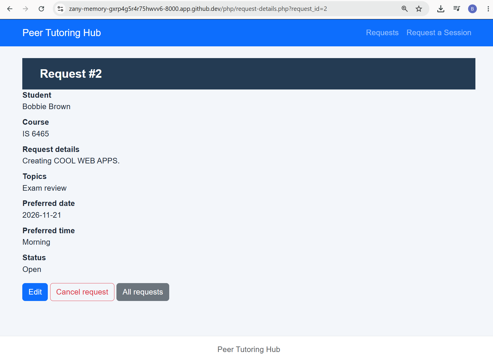
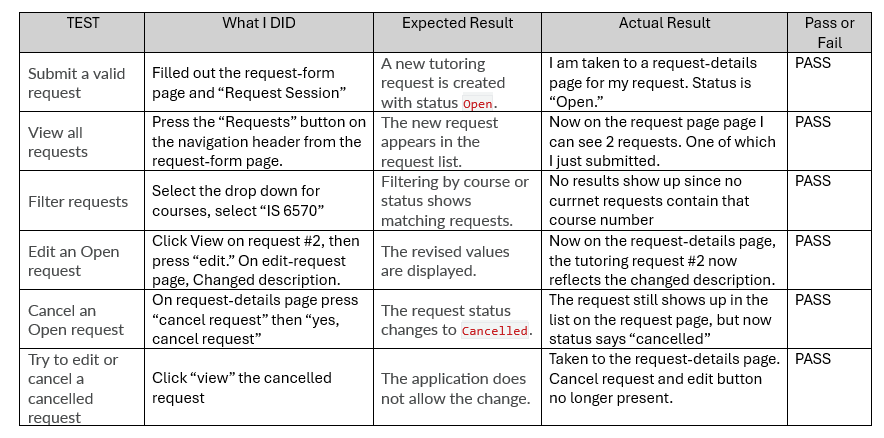
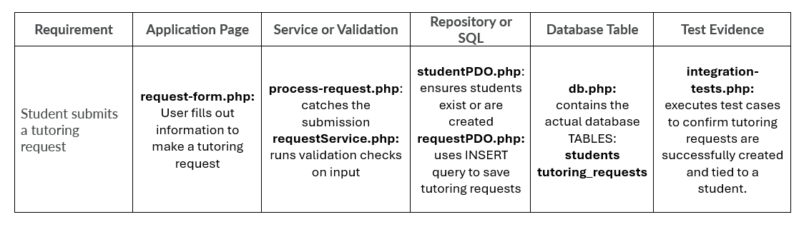

PART 1

    1)To create the tables in the tutoring.db database we ran the command "sqlite3 database/tutoring.db < database/setup-database.sql"
    which runs the setup-database.sql command against the tutoring.db database. 
    
    Then to confirm that tables were created we ran the .tables command in the terminal. The output contained "students" and "tutoring_request." This indicates that there are two tables in the database present with those names. Then to confirm there was information in each table I ran "Select * from students;" and "select * from tutoring_requests;"

        This was the output:
        1|Maria Lopez|maria.lopez@example.com
        1|1|IS 6465|PHP arrays and forms|2026-11-03|14:00|Open|2026-11-11 05:18:53

    This indicates that there is one student row/entry in the students tables and one rown/entry in the tutoring_requests table. 

PART 2

    1) https://zany-memory-gxrp4g5r4r75hwvv6-8000.app.github.dev/php/request-details.php?request_id=2

    2) After pressing submit I was taken to a page with a title of "Request 2." There is also an option to edit or cancel this request. To confirm that the request submitted, I clicked on the "Requests" link in the header which took me to a list of all requests. Two requests were present, the first one from Maria Lopez in the setup code we ran and this one. 

    3)part2.3.png in the images folder

PART 3

    1)part3.1.png in the images folder

PART 4
1) request-form.php
2) process-request.php
3) db.php 
4) requestService.php
5) setup-database.sql, studentPDO.php, requestPDO.php
6) students
7) tutoring_requests
8) A tutoring request connects to the student who submitted it via the student_id column. This is a primary key in the students table and a foreign key in the tutoring_request table. 
9) One of the most important reasons for putting SQL statements in repository files rather than the form page is to improve maintainability. First, it becomes easier to manage an application when we clearly seperate the layers. When we seperate SQL statements and the form page we are seperating the presentation and application layers of an application. Also, if we need to make changes to our database shcema, it is much easier to change a single file in a repository rather than every single form page that contains SQL statments.

PART 5

    (INPUT)
        php tests/integration-tests.php
    (OUTPUT)
    Xdebug: [Step Debug] Could not connect to debugging client. Tried: localhost:9000 (through xdebug.client_host/xdebug.client_port) :-(
        PASS UC01 create and Open
        PASS Lab 4 checkbox values preserved
        PASS Duplicate email reuses student
        PASS UC02 course and status filter
        PASS Invalid reason rejected
        PASS Invalid submission writes nothing
        PASS Edit Open request
        PASS Updated reason persisted
        PASS Cancel Open request
        PASS Cancelled row retained
        PASS Second cancellation rejected
        PASS Unrelated request unchanged
        PASS FK enforced
        PASS UC02 empty filter result
        All integration checks passed

PART 6

    1)
        -PROMPT: "With the 3 given skills packs and previous context of the web application provided earlier, Explain how a tutoring request moves from php/request-form.php through PHP, PDO, and SQLite in this project. Identify the responsibility of each file."
        
        -REPONSE: 
        1. Tutoring Request Data FlowA tutoring request moves through the application layers from the browser interface down to the SQLite database via the following step-by-step process:Browser Form (php/request-form.php): The user fills out inputs like student name, email, course, date, preferred time, and topic details. Submitting the form sends an HTTP POST request to the server.   Process Script (php/process-request.php): This script catches the POST request, verifies the form name, and delegates processing by calling submitRequest().   Service Layer (php/services/requestService.php): This file handles server-side validation and wraps database operations in a transaction using $pdo->beginTransaction().   Repositories (php/repositories/studentPDO.php & php/repositories/requestPDO.php): The service calls repository functions to run parameterized SQL statements—first ensuring the student exists (studentPDO.php) and then inserting the tutoring request record (requestPDO.php).   Database Connection (php/config/db.php): Provides the PDO connection configured with error handling and foreign key enforcement (PRAGMA foreign_keys = ON).   SQLite Database (database/tutoring.db): The changes are permanently committed to the SQLite database tables (students and tutoring_requests).   2. File Responsibilitiesphp/request-form.php: Renders the HTML form and user interface controls for capturing tutoring requests.   php/process-request.php: Acts as the entry-point controller that receives form submissions and triggers service execution.   php/config/db.php: Establishes and configures the reusable PDO connection to the SQLite database.   php/services/requestService.php: Validates input business rules and coordinates multi-step database transactions (commit/rollBack).   php/repositories/studentPDO.php: Contains the SQL queries responsible for finding and inserting student records.   php/repositories/requestPDO.php: Contains the SQL queries responsible for inserting, updating, and querying tutoring requests.   

        -EVALUATION: One accurate statement the AI made is that db.php file in the config folder provides the PDO connection. This is verified by looking at the code in the file. It contains a function that opens the data base tutoring.db and within that function is a section that starts a new PDO instace using "$pdo = new PDO("

    2)
        -PROMPT: "Trace the requirement “a student can submit a tutoring request” through the PHP files, service, repositories, SQLite tables, and integration tests in this project.

        -RESPONSE: Here is the complete trace of the requirement "a student can submit a tutoring request" through every layer of the project:1. Application Form & Controller:The user fills out details such as their name, email, course, preferred date, time, and topic selection in php/request-form.php.   The form submits via an HTTP POST request to php/process-request.php.   2. Service & Transaction Layer:php/process-request.php catches the submission and calls submitRequest() inside php/services/requestService.php.   requestService.php runs validation checks on all inputs and initiates an atomic database transaction using $pdo->beginTransaction().   3. Repository Layer & SQL:php/repositories/studentPDO.php ensures the student exists or is created using functions like insertStudentIfAbsent() and findStudentByEmail().   php/repositories/requestPDO.php executes a parameterized INSERT query via insertTutoringRequest() to save the tutoring request and link it using the student's ID.   4. Database Connection & SQLite Tables:The connection is established via php/config/db.php, which configures PDO, enables exceptions, and enforces foreign keys (PRAGMA foreign_keys = ON).   Data is persistently stored in the students and tutoring_requests tables within the SQLite database (database/tutoring.db) defined by setup-database.sql.   5. Integration Test Evidence:The requirement is verified automatically by php/tests/integration-tests.php, which executes test cases like submitRequest($pdo, $sample) to confirm that requests are successfully created with an Open status and properly linked.   

        -EVALUATION:part6.2.png found in images folder
    

    3)
        -PROMTPT: "Suggest one useful test case for the Peer Tutoring Hub application. The test must relate to request creation, filtering, editing, cancellation, validation, or database integrity."

        -RESPONSE: Here is a useful test case for the Peer Tutoring Hub application based on the project's existing integration tests:   Suggested Test Case: Duplicate Email Reuses StudentTest Objective: Verify that when a student submits a new tutoring request using an email address that already exists in the database, the system does not create a duplicate student record, but instead reuses the existing student profile.   Initial Database State: A student record has already been created in the students table (e.g., Jordan Lee with email jordan@example.edu).   Action / Input: Call submitRequest() with a new request payload using that same existing email address (jordan@example.edu).   Expected Result & Assertion:The total row count in the students table remains 1 rather than incrementing, thanks to INSERT OR IGNORE and email lookup logic.   The new tutoring request is successfully inserted into the tutoring_requests table and properly linked to the original student via their student_id foreign key.   Code Verification: This is tested in integration-tests.php using the assertion: check((int)$pdo->query('SELECT COUNT(*) FROM students')->fetchColumn()===1,'Duplicate email reuses student');.   

        1) Yes, the test they suggested is already found in the integration-tests.php file. It is to ensure that a duplicate email address only ties to 1 student ID (does not create duplicate students)
        2) To test this manully you would simply create a tutoring request with a given student email, name, topic, time, and course. Then submit a second request while maintaining the same email address but changing other information such as name, topic, time, or course. The integration file contains this portion to test for this case: check((int)$pdo->query('SELECT COUNT(*) FROM students')->fetchColumn()===1, 'Duplicate email reuses student');
        3) Yes, this test is appropriate for the application because it ensures that a new student entry is created every time that the same email address is used for a request. If this wasn't checked for it would create tons of duplicate entries in the database and make it extremely difficult to tie requests to specific students.

    4)The AI was very useful in explaining how the flow of the application works. When I asked it about how a tutoring request moves from the request-form to the SQLite database, it did an excellent job of breaking down what file is pointed to next in the process and where it is explicited stated in the code on each file. This helps isolate the syntax in these large files, making it easier to identify when looking over them again. Even though the AI is a useful tool to understanding the flow, it is crucial that a devloper tests these manually as well. AI often makes assumptions when it does not have the full context of scenario. This leads to it confidently giving answers to prompts when it may be wrong. The human oversight and verification in web development should never be overlooked.

PART 7

    After running the query:
    SELECT
        r.request_id,
        s.student_name,
        s.student_email,
        r.course,
        r.topic,
        r.preferred_date,
        r.preferred_time,
        r.status
    FROM tutoring_requests AS r
    JOIN students AS s
        ON r.student_id = s.student_id
    ORDER BY r.request_id;

    I received the output: 
    1|Maria Lopez|maria.lopez@example.com|IS 6465|PHP arrays and forms|2026-11-03|14:00|Open
    2|Bobbie Brown|bob.brown@utah.edu|IS 6465|{"reason":"Creating HOT web apps.","topics":["Exam review"]}|2026-11-21|Morning|Open
    3|Jenny Miller|jenny.miller@utah.edu|IS 6465|{"reason":"THANK YOU Thank you.","topics":["Exam review"]}|2026-12-05|Evening|Cancelled

    1) The JOIN in this query simply combines the students and tutorint_requests tables in the student_id column. Since the student_id is a primary and foreign key pair for both of these tables, the JOIN can be used to bring the tables tying students with a specific student_id to tutoring requests with a specific student_id. When running this query, if effectively lets you see the name and email address of the student associated with each tutoring request (which provides more context than just student id).

