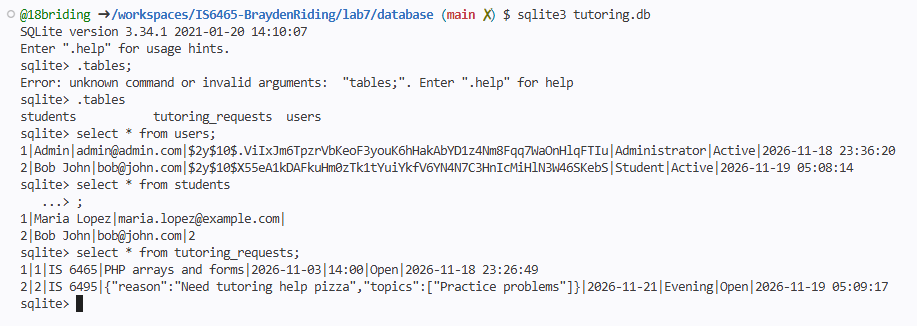

Part 1: Generate the Lab 7 Application

	1 generate code for all user management use cases UM-01 through UM-10 in the User Management Design Document.

    Use the Application Builder, Test Harness Generator, and Traceability Auditor documents as implementation guidance. Follow the authentication, authorization, session management, password hashing, CSRF protection, and role based access practices in the Authentication Reading Handout.

    Use lab6.zip as the existing Peer Tutoring Hub application to extend. Preserve the Lab 6 three tier architecture and update the application as needed to support user registration, login, logout, profile management, administrator access, and protected tutoring request workflows.

    Return a complete Lab 7 application package with all updated and new files. 

	2 IS6465_Authentication_Reading_Handout_v1.2.pdf, lab6.zip, skillspack.zip, Peer_Tutoring_Hub_User_Management_With_Diagrams.pdf

	3 Lab 6 was important because it added the database integration to the peer tutoring hub application. This made it so the peer tutoring hub will save and retreive tutoring requests. Lab 7 extends the lab 6 content by adding Authentication and Authorization to the application. This looks like adding users to the database and then provisioning user accounts to have access to specific resources on the website (a students view looks different than a teachers view).

	4 The register.php page was created by Google Gemini in accordance to use case UM-01. This use case is for creating new users according to their role (students and users). I verified this use case is functional by creating a student user with the name of Bob John.

Part 2: Set Up the Database

    1 sqlite3 tutoring.db < setup-database.sql
      sqlite3 tutoring.db < migrate-add-user.sql

    2 after entering the database via "sqlite3 tutoring.db" the command ".tables" output all current tables in the database. 

    The output: students           tutoring_requests  users 

    3 

Part 3: Create an Administrator Account

    1 php create-admin.php "Admin" admin@admin.com "___password___"

    2 I received an "Account has been created" message after running script. If I run a select * from users; statement, the first line output is: 
        1|Admin|admin@admin.com|$2y$10$.ViIxJm6TpzrVbKeoF3youK6hHakAbYD1z4Nm8Fqq7WaOnHlqFTIu|Administrator|Active|2026-11-18 23:36:20
    Which confirms that the Admin user was succesffully added to the user table of the database.

    3 admin@admin.com

    4 Administrator

Part 4: Run the Application

    1 https://zany-memory-gxrp4g5r4r75hwvv6-8000.app.github.dev/php/login.php
     
    2 After running the command "php -S 0.0.0.0:8000" the github app immediately had a pop up asking if I wanted to launch the url in a new tab. I clicked accept and was taken to a new chrome tab with the test web application.

    3 When I first opened the development server URL, I was immediately redirected to the login.php page which has the option to input current credentials or to register for a new account.

Part 5: Test the Student Workflow

    *table*
    *screenshot*

Part 6: Test the Administrator Workflow

    1
    2
    3
    4
    5
    *screenshot*

Part 7: Trace Registration and Login

    Student registration workflow
    1
    2
    3
    4
    5
    6
    7
    
    User login workflow
    1
    2
    3
    4
    5
    6
    7
    
    Why password hasing and verification should occur in app layer
      **2-4 sentences**

Part 8: Run the Automated Tests

    validation-tests.php
    Ouput:
    Status:
    1
    2
    3
    

    user-management-test.php
    Output:
    Status:
    1
    2
    3

    integration-tests.php
    Output:
    Status:
    1
    2
    3

Part 9: Use the AI Skills Pack Process

    Appliction Builder
    1

    Traceability Auiditor
    1 *table*

    Test Harness Generator
    1
    2
    3

    Skills Pack Reflection
    1 *3-5 sentences*

Part 10: Inspect the Database

    1
    2
    3
    4
    

